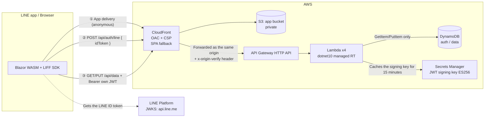

# template-aws-line-miniapp

English | [日本語](README.ja.md)

Template of a **per-user JSON data management service** for LINE MINI Apps (LIFF).
It delivers Blazor WebAssembly (.NET 10) with CloudFront + S3, authenticates with LINE Login, and stores a small amount of JSON per user in DynamoDB.

Authentication uses a **two-token scheme** (the LINE ID token is exchanged for the app's own JWT) and focuses solely on determining "whose request this is" in a way that cannot be forged. For the full design philosophy, see [SPEC.md](SPEC.md) (and its upstream `line-miniapp-spec-v2.md`).

> This template follows the same project structure, build/deploy procedures, and coding conventions as [template-aws-s3-wasm](../template-aws-s3-wasm). Only the authentication is replaced from Cognito with LINE + the own JWT, and the data store changes from S3 to DynamoDB.

---

## 📖 Overview

### What it does

- Sign in with LINE (LIFF) and get and save **only the user's own JSON data**
- Optimistic locking (`version`) prevents lost updates from simultaneous edits on multiple devices
- Account deletion (`DELETE /api/account`) deletes the authentication mapping and the data in one transaction
- The whole infrastructure is reproducible with CDK (C#) and can be deployed and removed with a few commands
- The main features can be verified automatically on AWS **without a real LINE device** (test JWKS mechanism)

### Core design principles (from [SPEC.md](SPEC.md) §1)

1. **Never trust the client** — anyone can call the endpoints with `curl`. The only thing to protect is determining whose request it is
2. **Chain of trust** — LINE private key → verified with the LINE public key → signed with the own private key → verified with the own public key → DynamoDB PK. The client's good faith is not relied on anywhere
3. **Authorization by key structure, not by if statements** — `PK = USER#{internalUserId from the token}`. Because `userId` does not exist in the API signatures, there is no path to another user's data at all

---

## 🏗️ Architecture



S3 is **only for static file delivery**. No bucket is created for user data (the data is in DynamoDB).

### AWS resources

| Resource | Purpose | Key points |
|---|---|---|
| S3 (app) | Blazor publish output | Block all public access / OAC only / autoDelete in dev |
| CloudFront | App delivery + API front | OAC / HTTPS enforced / 403 and 404 → `/index.html` / security headers + CSP / `/api/*` with caching disabled and `x-origin-verify` added |
| API Gateway HTTP API | API entry point | No authorizer (JWT validation is in Lambda). localhost CORS in dev only. Stage throttling |
| Lambda ×4 | auth-line / data-get / data-put / account-delete | dotnet10 managed runtime / 256MB / 10 seconds / share one publish artifact |
| DynamoDB ×2 | AuthTable / DataTable | On-demand / PITR in prod only / DESTROY in dev |
| Secrets Manager | JWT signing key (ES256 PEM) | CDK creates only the container, and `init-jwt-key.ps1` puts the value. Lambda caches it for 15 minutes |
| CloudWatch Logs | Lambda logs | 1 week in dev / 1 month in prod |

### Why the JWT is validated in Lambda (difference from the S3 + Cognito template)

template-aws-s3-wasm authenticates with the JWT authorizer of API Gateway. In this template, **the app issues and validates its own JWT**, so authentication is done in Lambda (`OriginVerifyFilter` + `OwnTokenValidator`). API Gateway handles only routing and throttling, and all authentication and authorization is in the code. This follows inevitably from the two-token scheme of the v2 spec (the own JWT avoids the one-hour limit of LINE).

### Lambda implementation style (AmazonLambdaExtension)

The handlers are written with [AmazonLambdaExtension](https://github.com/usausa/amazon-lambda-extension) (a source generator. NuGet `2.0.0-beta4`, generator included).

- Four `[HttpApi(method, path)]` methods in the single class `MiniAppFunction` marked with `[Lambda]`. The Lambda entry point `{Method}_Handler` of each method is generated in the same class
- Parameters are received with `[FromBody]` (SG-based JSON + DataAnnotations validation, and invalid JSON returns 400) and `[FromHeader("authorization")] string authorization = ""` (headers **require a default value**. Nullable annotated types such as `string?` are not supported for binding = ALE0019)
- The x-origin-verify check is applied to the whole class as an `ILambdaFilter` (`OriginVerifyFilter`). The JWT validation is deliberately placed at the top of each handler to keep it visible that "`sub` comes only from a validated token"
- DI uses `[ServiceResolver(typeof(ServiceResolver))]` + `ServiceResolver.ConfigureServices()`. `ILambdaSerializer` / `IBodySerializer` / `IRequestValidator` are also registered here
- The route template of `[HttpApi]` serves as documentation and for route parameter binding, and the actual routing is on the CDK side (keeping the template's policy of "infrastructure definitions in one place")
- Unlike Amazon.Lambda.Annotations, `serverless.template` is not generated (no removal target is needed)

> The Amazon.Lambda.Annotations version before the conversion is saved as a snapshot in `../template-aws-line-miniapp-backup`.

---

## 🔐 Authentication (two-token scheme)

| | LINE ID token | Own JWT |
|---|---|---|
| Issuer | LY Corporation | Own Lambda |
| Signature | ES256 (LINE private key, verified with JWKS) | ES256 (key in Secrets Manager) |
| Lifetime | **1 hour, cannot be changed** | **7 days** (`JWT_LIFETIME_DAYS`) |
| Validated at | `POST /api/auth/line` only | All protected APIs (shared in Lambda) |
| Stored in | localStorage of LIFF (not touched) | **Memory only** (`TokenStore`. localStorage is prohibited) |

Right after startup, the ID token is exchanged for the own JWT only once, and the LINE token is not used after that. This removes the "silently breaks after one hour" problem by design. For details and the four expiration states, see [SPEC.md](SPEC.md) §4 / `line-miniapp-spec-v2.md` §2-3.

Claims of the own JWT: `sub`=internalUserId (`usr_`+GUID v7), `line_sub`=lineUserId (used only to delete from AuthTable on account deletion, **must not be logged**).

---

## 📇 Data model (DynamoDB)

| Table | PK | Others |
|---|---|---|
| AuthTable | `LINE#{lineUserId}` | `internalUserId`, `createdAt` |
| DataTable | `USER#{internalUserId}` | `data`(JSON string), `version`(optimistic lock), `updatedAt` |

No sort key / no GSI / on-demand. One item per user, with a single access pattern. `Scan`/`Query` are explicitly denied by IAM ([SPEC.md](SPEC.md) §9.4).

---

## 🔧 Creating a new project from the template

There are two kinds of names to replace.

| Kind | Current value | Used in |
|---|---|---|
| Project name (PascalCase) | `Template` | Namespaces, project names, directory names, assembly names, **Lambda handler names** |
| Deploy name (kebab-case) | `template-aws-line-miniapp` | CloudFormation stack name, part of the S3 names |

Run at the repository root (change the first two lines to your own values):

```powershell
$Name   = 'Acme'              # PascalCase. Becomes the namespaces and assembly names
$Deploy = 'acme-miniapp'      # kebab-case. Becomes the CloudFormation stack name

# 1. Replace the file contents (excluding .git and the output directories)
Get-ChildItem -Recurse -File |
    Where-Object { $_.FullName -notmatch '\\(\.git|bin|obj|publish|publish-api|cdk\.out|node_modules)\\' } |
    ForEach-Object {
        $body = Get-Content $_.FullName -Raw
        $new = $body.Replace('Template.', "$Name.").Replace('template-aws-line-miniapp', $Deploy)
        if ($new -ne $body) { Set-Content $_.FullName $new -NoNewline }
    }

# 2. Rename the project files and directories
foreach ($p in 'Backend', 'Frontend', 'IaC') {
    Rename-Item "Template.$p/Template.$p.csproj" "$Name.$p.csproj"
    Rename-Item "Template.$p" "$Name.$p"
}
Get-ChildItem -Filter 'Template.*.slnx' | ForEach-Object { Rename-Item $_.FullName ($_.Name -replace '^Template', $Name) }

# 3. Verify
dotnet build
```

> ⚠️ Always replace **`Template.` with the dot** (replacing `Template` alone also hits other occurrences, such as the word "Template" in descriptions).
> ⚠️ The most error-prone place is the **Lambda handler names** in `Template.IaC/ApiConstruct.cs`. Even if the strings are wrong, `cdk deploy` succeeds, and **only the API calls fail with 500 at run time**. The replacement above fixes them, but suspect this place first when renaming by hand.

---

## 🚀 Setup (initial build)

### Requirements

- .NET SDK 10.0+
- Node.js 20+ (to run the CDK CLI)
- AWS CLI v2 (with credentials configured)
- PowerShell 7+

### Preparation

Set the values of each environment in `Template.IaC/cdk.json`.

| Key | Description |
|---|---|
| `lineChannelId` | ID of the LINE MINI App / LINE Login channel (used to validate `aud` of the ID token) |
| `liffId` | ID of the LIFF app whose endpoint URL is set to the deployment (CloudFront) |
| `liffIdLocal` | ID of the LIFF app for local development (`https://localhost:5250`) (dev only) |
| `allowLocalhost` | `true` in dev (adds localhost CORS to the HTTP API) |
| `testJwks` | Can be `true` in dev only (uses the test JWKS so that verification works without a real device). **Setting it to true in prod makes synth fail** |

> The bundled `dev` contains dummy values (such as `lineChannelId: "2000000001"`) that pass the automated verification as is. Replace them with real values when using a real device.

### Build steps

```powershell
# 1. Prepare the Lambda artifact (CDK takes it in as an asset)
./scripts/deploy-api.ps1

# 2. Deploy the infrastructure
cd Template.IaC
npx --yes aws-cdk@latest bootstrap        # Only the first time per account × region
npx --yes aws-cdk@latest deploy -c env=dev --require-approval never --outputs-file ../cdk-outputs.dev.json
cd ..

# 3. Put the JWT signing key (idempotent. Skipped if a real key already exists)
./scripts/init-jwt-key.ps1 -Env dev

# 4. Build and deliver the app
./scripts/deploy-app.ps1 -Env dev

# 5. (Automated verification) Run the acceptance tests without a real device or LINE settings
./scripts/test-acceptance.ps1 -Env dev

# 6. (Verification on a real device) Change the LIFF endpoint URL to the CloudFront domain in LINE Developers,
#    and open the LIFF URL from the LINE app
```

The first milestone is "`POST /api/auth/line` works end to end". With `testJwks`, it can be checked **before using a real device**.

---

## ✅ Acceptance tests (`test-acceptance.ps1`)

Requires dev + `testJwks=true`. The script generates a P-256 test key, places its public key in the app bucket as the **test JWKS**, forges a LINE-format ID token with the private key, and verifies all paths from `POST /api/auth/line` onward on real AWS (the test key is not a real LINE key, and it passes only because dev points `LINE_JWKS_URL` to this JWKS).

| # | Test | Expected |
|---|---|---|
| 1 | `GET /api/data` without a token | 401 |
| 2 | `?userId=...` is ignored (the API has no parameter for it) | Same result with or without the parameter |
| 3 | Tamper with `sub` of the own JWT | 401 (signature mismatch) |
| 4 | JWT with `alg=none` | 401 |
| 5 | Exchange with an expired LINE ID token | 401 (exp validation) |
| 6 | Exchange with a LINE token whose `aud` is another channel | 401 |
| 7 | `PUT` with an old version | 409 |
| 8 | `PUT` over 300KB | 413 |
| 9 | Direct access to execute-api (bypassing CloudFront) | 403 (no `x-origin-verify`) |
| 10 | Lifecycle (exchange → 204 → PUT → GET → delete account → 204) | All PASS |
| 11 | The same LINE user gets the same internalUserId, and a new one after account deletion | PASS |

**Verification record (2026-08-30)**: Deployed once to the dev environment, confirmed that all 11 items above PASS, also checked the front-end delivery (CSP, WASM boot), and then **removed** it. After converting the implementation to AmazonLambdaExtension on the same day, redeployed, reconfirmed that all 11 items PASS, and **removed** it again. No stack exists on AWS.

---

## 🧹 Removal (cleanup)

```powershell
cd Template.IaC
npx --yes aws-cdk@latest destroy -c env=dev --force
cd ..
```

In dev, all resources are set to DESTROY, so in principle nothing is left. However, the LogGroup of the bucket-emptying Lambda built into CDK (`/aws/lambda/{stack name}-CustomS3AutoDeleteObject-*`) may remain because it is outside CloudFormation management (empty, no charge). To remove it manually:

```powershell
aws logs describe-log-groups --query "logGroups[?contains(logGroupName,'template-aws-line-miniapp')].logGroupName" --output text |
    ForEach-Object { $_ -split '\s+' } | Where-Object { $_ } |
    ForEach-Object { aws logs delete-log-group --log-group-name $_ }
```

In **prod**, the bucket, DynamoDB, and Secret are RETAIN, so they must be removed manually after deleting the stack (an intentional design to protect the data).

Check for leftovers:

```powershell
aws cloudformation describe-stacks --stack-name template-aws-line-miniapp-dev   # A "does not exist" error is expected
aws s3api list-buckets --query "Buckets[?contains(Name,'template-aws-line-miniapp')].Name"
aws dynamodb list-tables --query "TableNames[?contains(@,'template-aws-line-miniapp')]"
aws secretsmanager list-secrets --include-planned-deletion --query "SecretList[?contains(Name,'SecretJwtSigningKey')].Name"
```

---

## 📁 Program structure

```
template-aws-line-miniapp/
├── SPEC.md                                  ← Implementation spec (mapped from the v2 spec. Upstream of this README)
├── Template.Backend/                        ← Lambda (net10.0, managed dotnet10)
│   ├── ServiceResolver.cs                   ← DI registration (referenced from [ServiceResolver])
│   ├── Functions/MiniAppFunction.cs         ← [Lambda] + [HttpApi]×4 (AuthLogin/DataGet/DataPut/AccountDelete)
│   ├── Filters/OriginVerifyFilter.cs        ← x-origin-verify check (ILambdaFilter, shared by the class)
│   ├── Application/BackendOptions.cs        ← Reads the environment variables
│   ├── Services/                            ← LineTokenValidator / SigningKeyProvider / JwtIssuer / OwnTokenValidator / UserRepository
│   └── Models/                              ← Contracts (AuthLogin/DataGet/DataPut. With DataAnnotations validation)
├── Template.Frontend/                       ← Blazor WebAssembly (net10.0)
│   ├── Services/                            ← LiffService / TokenStore (kept in memory) / ApiClient (re-exchanges only once on 401)
│   ├── Components/Pages/                    ← Home / Data / Account / NotFound
│   └── wwwroot/js/liff-interop.js           ← Wrapper of v2 §3.2 (an external file, for CSP)
├── Template.IaC/                            ← AWS CDK (C#)
│   ├── Infrastructure.cs                    ← Stack body + Outputs
│   ├── HostingConstruct.cs                  ← S3 + CloudFront (/api/* + x-origin-verify + CSP)
│   ├── ApiConstruct.cs                      ← HTTP API + Lambda ×4 + IAM (Scan/Query explicitly denied)
│   ├── DataConstruct.cs / SecretConstruct.cs
│   └── EnvironmentConfig.cs / cdk.json / Program.cs
├── scripts/                                 ← See below
└── README.md / AGENTS.md / Analyzers.ruleset / Directory.Build.*
```

### Scripts

| Script | Purpose |
|---|---|
| `deploy-api.ps1` | Publishes Template.Backend to `publish-api/` (required **before cdk deploy**. Also needed for destroy) |
| `init-jwt-key.ps1` | Generates an ES256 key pair and puts it into Secrets Manager (idempotent. `-Force` regenerates it = all existing JWTs become invalid) |
| `update-appsettings.ps1` | Generates `appsettings.Development.json` for local development (LiffId is the local one) |
| `deploy-app.ps1` | Publishes Template.Frontend → S3 sync → promotes to the immutable cache → replaces with Brotli → invalidation |
| `test-acceptance.ps1` | The automated acceptance tests above (requires dev + testJwks) |
| `common.ps1` | Shared processing (reading cdk outputs, etc.). Do not run it directly |

---

## 💻 Local development

```powershell
./scripts/update-appsettings.ps1 -Env dev
dotnet run --project Template.Frontend       # https://localhost:5250
```

- Because LIFF requires https, set the endpoint of the local LIFF app to `https://localhost:5250` (requires `dotnet dev-certs https --trust`).
- The API calls go to CloudFront `/api/*` of the dev stack (cross-origin. localhost CORS is set on the HTTP API in dev only). Because they go through CloudFront, `x-origin-verify` is added, which is compatible with the direct-access blocking of test 9.

---

## 🛡️ Security

| Attack | Result | Stopped by |
|---|---|---|
| Call the API directly with `curl` | 401 | No token |
| Put `userId=someone else` in the parameters | Ignored | The server does not accept `userId` |
| Rewrite `sub` of the JWT | 401 | Signature validation |
| Change `alg` to `none`/`HS256` | 401 | `ValidAlgorithms=[ES256]` fixed |
| LINE token of another channel | 401 | `aud` validation |
| Modify and redistribute the WASM | **Nothing happens** | The server makes all decisions |
| Directly to execute-api (bypassing CloudFront) | 403 | `x-origin-verify` (defense in depth. JWT validation remains even if it is bypassed) |

- **CSP is added by CloudFront** (`HostingConstruct.Csp`). `connect-src` is `'self'` + `api.line.me`, `script-src` is `'self' 'wasm-unsafe-eval'` + `static.line-scdn.net`, and `img-src` includes `profile.line-scdn.net`. Because the hosts that the LIFF SDK connects to are not officially listed in full, add hosts when a CSP violation occurs on a real device.
- The own JWT is **not stored in localStorage** (memory only). `lineUserId` is not logged. Raw tokens are not displayed on screen.
- The signing key is only in Secrets Manager. Environment variables hold only the ARN (no key material).

For details, see [SPEC.md](SPEC.md) §10 and `line-miniapp-spec-v2.md` §8.

---

## 💰 Running costs

| Service | Demo use (a few users) | 100K MAU |
|---|---|---|
| DynamoDB | ~$0.01 | ~$3 |
| Lambda | $0 (free tier) | ~$2 |
| CloudFront + S3 | $0-0.01 | $5-10 |
| API Gateway (HTTP API) | ~$0.01 | ~$4 |
| Secrets Manager | $0.40 | $0.40 |
| **Total** | **About $0.4/month** | **About $15-20/month** |

Except for $0.40/month for Secrets Manager, almost everything is within the free tier. If the request charges of API Gateway become a problem in production, replace it with Lambda Function URL + OAC as in the v2 spec (this requires a design change that moves the routing into a single Lambda).

---

## 📋 Known limitations

| Item | Description |
|---|---|
| Lambda cold start | The managed runtime needs JIT warm-up on the first call (about 700ms measured). Native AOT would reduce it, but it is not adopted because building for Linux on Windows needs Docker |
| Hosts covered by CSP | The hosts that the LIFF SDK connects to are not published. Check for violations in the first test on a real device and add them ([SPEC.md](SPEC.md) §10.1) |
| First front-end download | Several MB with WASM + AOT. Accepted on the assumption that caching works well for mini apps inside LINE ([SPEC.md](SPEC.md) §1 #6) |
| testJwks | dev only. In prod, EnvironmentConfig throws an exception at synth time, so it structurally cannot be brought in |
| Current deployment state | Deployed and verified once, then **removed**. No stack exists on AWS |
| CI/CD | Not included |

---

## 📄 License

See [LICENSE](LICENSE).
