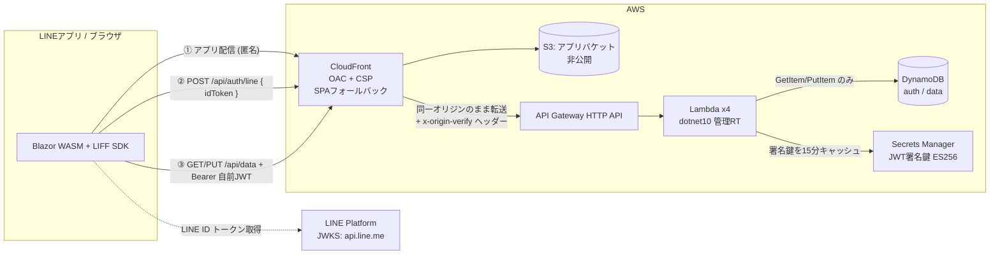

# 設計

認証は **2 トークン方式**（LINE の ID トークン → 自前 JWT に載せ替え）で、「このリクエストは誰のものか」を偽造不可能な形で確定させることだけに集中している。設計思想の全文は [SPEC.md](../SPEC.md)（およびその上流の `line-miniapp-spec-v2.md`）を参照。

> このテンプレートは [template-aws-s3-wasm](https://github.com/usausa/template-aws-s3-wasm) と同じプロジェクト構造・ビルド/デプロイ手順・コーディング規約を踏襲している。認証だけが Cognito から LINE + 自前 JWT に置き換わり、データストアが S3 から DynamoDB に変わっている。

## 設計の中心思想（[SPEC.md](../SPEC.md) §1 より）

1. **クライアントを一切信頼しない** — エンドポイントは誰でも `curl` で叩ける。守るのは「誰のリクエストか」の確定だけ
2. **信頼の連鎖** — LINE の秘密鍵 → LINE 公開鍵で検証 → 自前秘密鍵で署名 → 自前公開鍵で検証 → DynamoDB の PK。どこにもクライアントの善意が入らない
3. **認可を if 文でなくキー構造にする** — `PK = USER#{トークン由来の internalUserId}`。API のシグネチャに `userId` が存在しないため、他人のデータへ渡す経路自体が無い

## 🏗️ アーキテクチャ

S3 は**静的ファイル配信のみ**。ユーザーデータ用バケットは作らない（データは DynamoDB）。

### AWS リソース

| リソース | 用途 | 要点 |
|---|---|---|
| S3（アプリ） | Blazor publish 出力 | パブリックアクセス全ブロック / OAC のみ / dev は autoDelete |
| CloudFront | アプリ配信 + API 前段 | OAC / HTTPS 強制 / 403・404→`/index.html` / セキュリティヘッダー + CSP / `/api/*` はキャッシュ無効・`x-origin-verify` 付与 |
| API Gateway HTTP API | API の入口 | オーソライザーなし（JWT 検証は Lambda 内）。dev のみ localhost CORS。ステージスロットリング |
| Lambda ×4 | auth-line / data-get / data-put / account-delete | dotnet10 管理ランタイム / 256MB / 10秒 / 1 publish 成果物を共有 |
| DynamoDB ×2 | AuthTable / DataTable | オンデマンド / PITR は prod のみ / dev は DESTROY |
| Secrets Manager | JWT 署名鍵（ES256 PEM） | CDK は器のみ、値は `init-jwt-key.ps1` で投入。Lambda は 15 分キャッシュ |
| CloudWatch Logs | Lambda ログ | dev 1週間 / prod 1か月 |

### なぜ Lambda 内で JWT を検証するのか（S3+Cognito テンプレートとの違い）

template-aws-s3-wasm は API Gateway の JWT オーソライザーで認証する。本テンプレートは**アプリが自前で JWT を発行・検証する**ため、認証は Lambda 内（`OriginVerifyFilter` + `OwnTokenValidator`）で行う。API Gateway が担うのはルーティングとスロットリングだけで、認証・認可はすべてコード側にある。これは v2 仕様の 2 トークン方式（LINE の 1 時間制約を回避するための自前 JWT）を成立させるための必然的な帰結。

### Lambda の実装形態（AmazonLambdaExtension）

ハンドラーは [AmazonLambdaExtension](https://github.com/usausa/amazon-lambda-extension)（ソースジェネレーター。NuGet `2.0.0-beta4`、ジェネレーター同梱）で記述している。

- `[Lambda]` を付けた単一クラス `MiniAppFunction` に `[HttpApi(method, path)]` メソッド×4。各メソッドの Lambda エントリポイント `{Method}_Handler` が同クラスに生成される
- パラメーターは `[FromBody]`（SG ベースの JSON + DataAnnotations 検証で不正 JSON は 400）と `[FromHeader("authorization")] string authorization = ""` で受ける（ヘッダーは**既定値必須**。`string?` などの null 許容注釈型はバインディング非対応 = ALE0019）
- x-origin-verify の検証は `ILambdaFilter`（`OriginVerifyFilter`）としてクラス共通に適用。JWT 検証は「`sub` の出所が検証済みトークンのみ」を可視に保つため、あえて各ハンドラー先頭に置いている
- DI は `[ServiceResolver(typeof(ServiceResolver))]` + `ServiceResolver.ConfigureServices()`。`ILambdaSerializer` / `IBodySerializer` / `IRequestValidator` もここで登録する
- `[HttpApi]` のルートテンプレートはドキュメント兼ルートパラメーターバインディング用で、実ルーティングは CDK 側にある（テンプレートの「インフラ記述を1箇所に」方針を維持）
- Amazon.Lambda.Annotations と異なり `serverless.template` は生成されない（削除ターゲット不要）

> 変換前の Amazon.Lambda.Annotations 版は `../template-aws-line-miniapp-backup` にスナップショットとして保存してある。

## 🔐 認証（2 トークン方式）

| | LINE ID トークン | 自前 JWT |
|---|---|---|
| 発行者 | LINE ヤフー | 自 Lambda |
| 署名 | ES256（LINE 秘密鍵、JWKS で検証） | ES256（Secrets Manager の鍵） |
| 有効期限 | **1時間・変更不可** | **7日**（`JWT_LIFETIME_DAYS`） |
| 検証場所 | `POST /api/auth/line` のみ | 全保護 API（Lambda 内共通） |
| 保管場所 | LIFF の localStorage（触らない） | **メモリのみ**（`TokenStore`。localStorage 禁止） |

起動直後に ID トークンを 1 回だけ自前 JWT に交換し、以後 LINE トークンは使わない。これで「1 時間で黙って壊れる」問題が設計から消える。詳細と 4 つの期限切れ状態は [SPEC.md](../SPEC.md) §4 / `line-miniapp-spec-v2.md` §2〜3。

自前 JWT のクレーム: `sub`=internalUserId（`usr_`+GUID v7）、`line_sub`=lineUserId（退会時の AuthTable 削除にのみ使用・**ログ出力禁止**）。

## 📇 データモデル（DynamoDB）

| テーブル | PK | その他 |
|---|---|---|
| AuthTable | `LINE#{lineUserId}` | `internalUserId`, `createdAt` |
| DataTable | `USER#{internalUserId}` | `data`(JSON文字列), `version`(楽観ロック), `updatedAt` |

ソートキーなし / GSI なし / オンデマンド。1 ユーザー 1 アイテム、アクセスパターンは 1 種類。`Scan`/`Query` は IAM で明示 Deny（[SPEC.md](../SPEC.md) §9.4）。

## 🛡️ セキュリティ

| 攻撃 | 結果 | 止まる場所 |
|---|---|---|
| `curl` で API を直接叩く | 401 | トークンなし |
| `userId=他人` をパラメータに入れる | 無視 | サーバが `userId` を受け取らない |
| JWT の `sub` を書き換え | 401 | 署名検証 |
| `alg` を `none`/`HS256` に | 401 | `ValidAlgorithms=[ES256]` 固定 |
| 別チャネルの LINE トークン | 401 | `aud` 検証 |
| WASM を改造して再配布 | **何も起きない** | サーバが全判断 |
| execute-api へ直接（CloudFront 迂回） | 403 | `x-origin-verify`（多層防御。突破されても JWT 検証が残る） |

- **CSP は CloudFront で付与**（`HostingConstruct.Csp`）。`connect-src` は `'self'` + `api.line.me`、`script-src` は `'self' 'wasm-unsafe-eval'` + `static.line-scdn.net`、`img-src` に `profile.line-scdn.net`。LIFF SDK の通信先は公式に網羅列挙されていないため、実機で CSP violation が出たらホストを追記する。
- 自前 JWT は **localStorage に保存しない**（メモリのみ）。`lineUserId` はログ出力しない。生トークンは画面表示しない。
- 署名鍵は Secrets Manager のみ。環境変数には ARN だけ（鍵素材は置かない）。

詳細は [SPEC.md](../SPEC.md) §10 と `line-miniapp-spec-v2.md` §8。
